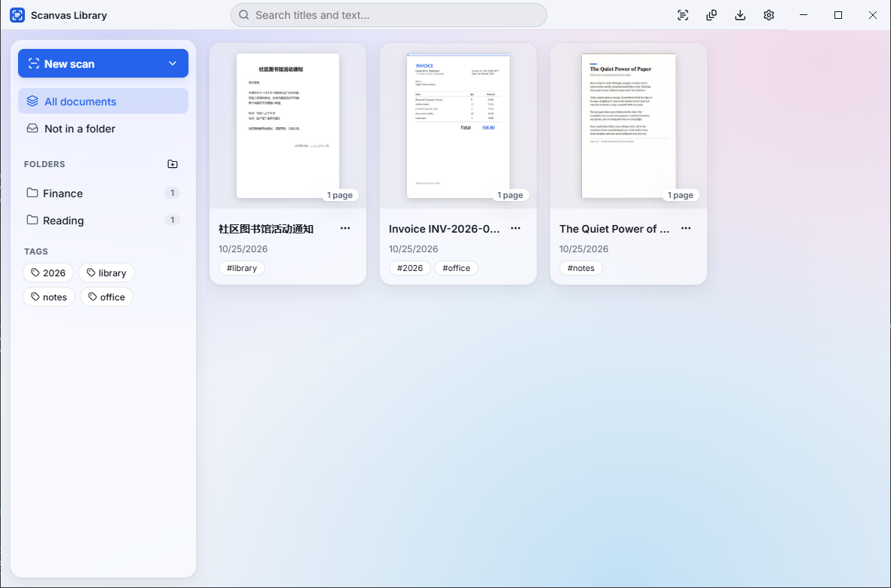
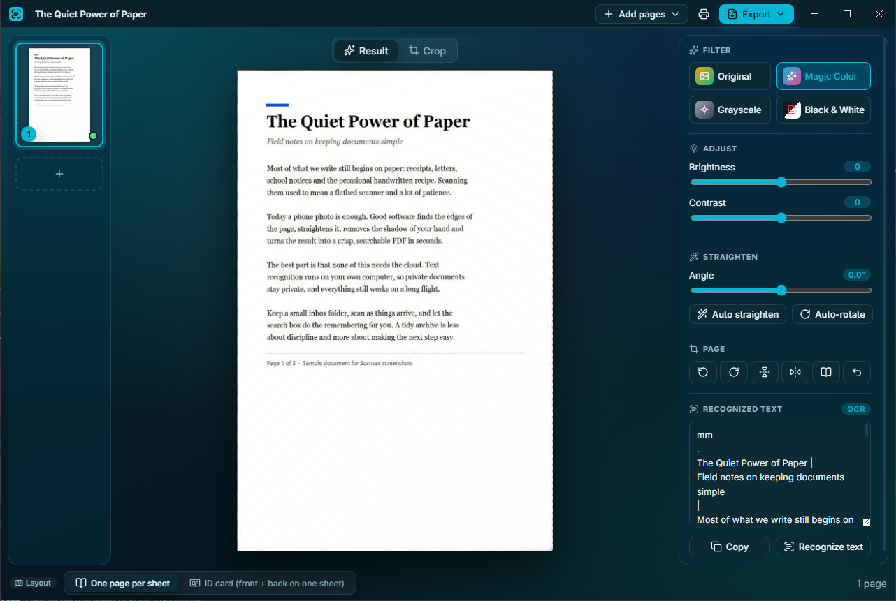
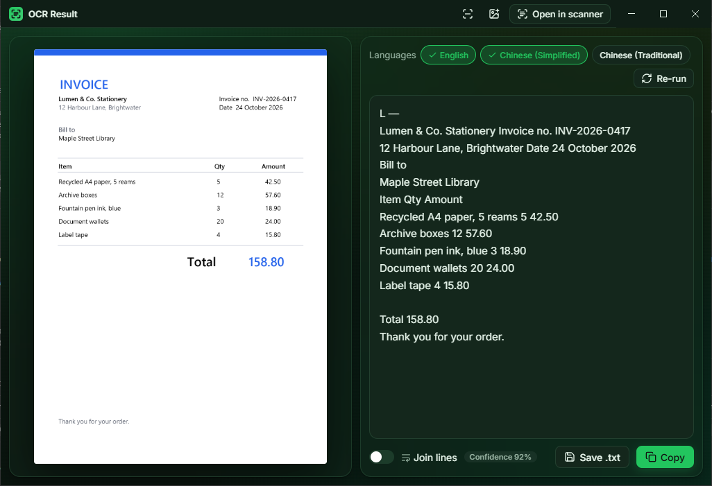
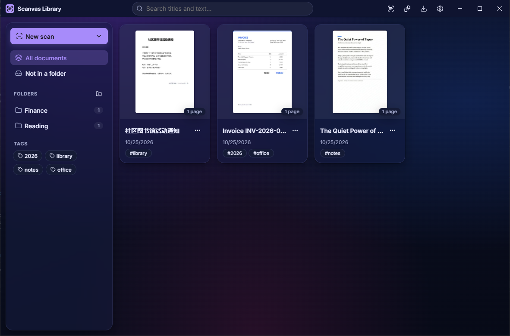
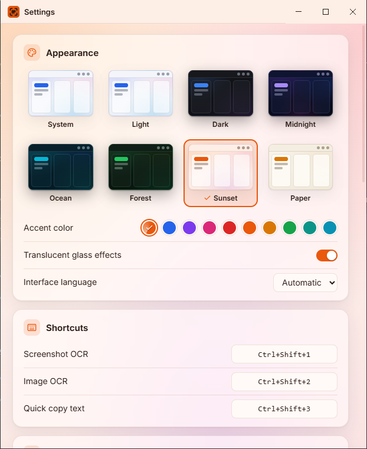

<div align="center">


# Scanvas

**Offline screenshot OCR and document scanner for the desktop.**

Grab text from anywhere on screen, turn phone photos into clean printable pages, and keep everything searchable. Text recognition, page cleanup and PDFs all run on your own machine. There are no accounts, no uploads and no cloud.


**[⬇ Download for Windows](https://github.com/dimuthun/Scanvas/releases/latest)**



</div>

## Screenshots

| | |
|---|---|
|  |  |
| **Editor**: a tilted phone photo of a page on a desk, automatically cropped, straightened and cleaned up. Filters, adjustments and the recognized text are on the right. | **OCR result**: the image and editable text side by side, with language choice, line joining, confidence and copy/save. |
|  |  |
| **Library** in the Midnight theme, with full-text search, folders and tags. Chinese text is recognized too. | **Appearance settings**: 8 themes with live previews, 10 accent colors and the glass effect switch. |

*All screenshots use made-up sample documents.*

---

## Contents

- [Screenshots](#screenshots)
- [Features](#features)
- [Install](#install)
- [Using Scanvas](#using-scanvas)
- [Development](#development)
- [Building installers](#building-installers)
- [Architecture](#architecture)
- [Theming](#theming)
- [Localization](#localization)
- [Privacy & security](#privacy--security)
- [Troubleshooting](#troubleshooting)
- [Acknowledgements](#acknowledgements)
- [License](#license)

---

## Features

### Screenshot & image OCR
- **Screenshot OCR** (`Ctrl+Shift+1`): freeze the screen, select a region on any monitor, and get editable text.
- **Quick copy** (`Ctrl+Shift+3`): select a region and the recognized text goes straight to the clipboard. No window opens.
- **Image OCR** (`Ctrl+Shift+2`): open, drag in, or paste (`Ctrl+V`) any image.
- **Precise selection:** resize handles, a size label, and a pixel magnifier that shows X·Y coordinates and the color under the cursor.
- **Readable output:**
  - Paragraphs are preserved, with an optional "join lines" mode.
  - Recognition languages can be switched and re-run.
  - Results can be saved as `.txt`.
- **QR codes & barcodes** are decoded automatically, with copy and open-link actions.
- **Languages:** English, Simplified Chinese and Traditional Chinese models are bundled.

### Document scanning
- **Automatic page detection:** finds the page edges in a photo, with a 4-corner perspective crop and a magnifier for fine adjustment.
- **Straighten & auto-rotate:** fixes small tilts automatically and turns sideways or upside-down pages upright.
- **Filters:** Original, Magic Color, Grayscale and Black & White, plus shadow removal, brightness and contrast.
- **Page tools:** rotate, flip, reorder by drag-and-drop, delete, and reset edits.
- **Book mode:** splits a two-page spread at the gutter and straightens each half.
- **ID-card mode:** puts the front and back on one sheet at true ID-1 size (85.6 × 54 mm).

### Import & export
- **Import from:**
  - images (single, multiple, or a whole folder);
  - PDFs (each page becomes an editable page);
  - **WIA scanners** on Windows.
- **Export to:**
  - **Searchable PDF** with an invisible OCR text layer. Paper size is A4, Letter or fit-to-image, with margins and quality presets.
  - **Word (.docx)**, **images**, or **plain text**.
- **Print** directly with correct paper sizing.
- **Export manager:** asks where to save, shows progress, and offers **Open folder** when done.

### PDF tools
- **Merge** several PDFs into one.
- **Split** every N pages or by ranges (`1-3, 5, 8-`).
- **Reorder, rotate and remove** pages visually, with multi-select and drag-and-drop.

### Library
- **Organize** documents with folders and tags; drag a document onto a folder to move it.
- **Full-text search** across titles and recognized text, including Chinese, with highlighted matches and the matching page.
- **Watch folder:** files dropped into a chosen folder become cleaned-up, searchable PDFs automatically.

### Look & feel
- **Modern glass UI:** translucent panels, soft gradient backdrops, smooth animations and a custom title bar.
- **Themes and accents:** 8 themes (System, Light, Dark, Midnight, Ocean, Forest, Sunset, Paper) and 10 accent colors, with a live preview.
- **Tray app** with configurable global shortcuts.
- **Interface languages:** English, 简体中文 and 繁體中文.

---

## Install

### Windows
1. **[⬇ Download Scanvas-Setup-0.1.0.exe](https://github.com/dimuthun/Scanvas/releases/download/v0.1.0/Scanvas-Setup-0.1.0.exe)** (155 MB, Windows 10/11 x64) from the [latest release](https://github.com/dimuthun/Scanvas/releases/latest), or build it yourself (see [Building installers](#building-installers)).
2. Run the installer. Scanvas installs for the current user, so no admin rights are needed. It adds:
   - a **desktop shortcut**,
   - a **Start Menu** entry,
   - an entry in **Settings → Apps** (with an uninstaller).

> The installer is not code-signed yet, so Windows SmartScreen may show "Windows protected your PC". Choose **More info → Run anyway**.

Uninstalling keeps your library and settings in `%APPDATA%\Scanvas`.

### macOS / Linux
Build from source with `npx electron-builder --mac` or `--linux` (DMG / AppImage targets are configured). These platforms are untested so far. On macOS, grant **Screen Recording** permission when prompted.

---

## Using Scanvas

| Action | How |
|---|---|
| Screenshot OCR | `Ctrl+Shift+1`, or right-click the tray icon → *Screenshot OCR* (left-click opens the library) |
| Quick copy text | `Ctrl+Shift+3`, or in the capture toolbar click *Copy text* (`Ctrl+Enter`) |
| Image OCR | `Ctrl+Shift+2`, or drop/paste an image into the result window |
| New scan | Library → **New scan** → images / folder / PDF / scanner |
| Confirm / cancel a selection | `Enter` or double-click / `Esc` or right-click |

All shortcuts can be changed in **Settings → Shortcuts**.

### Command line
Scanvas runs as a single instance. Running it again with one of these arguments controls the instance that is already running, which is handy for shortcuts, "Open with" and scripts:

```bash
Scanvas.exe photo1.jpg photo2.jpg scan.pdf   # new scanned document from these files
Scanvas.exe --ocr=C:\path\to\image.png       # recognize the text of an image
Scanvas.exe --capture                        # start a screenshot-OCR selection
Scanvas.exe --open=library                   # also: settings | pdftools | downloads
Scanvas.exe --doc=<document-id>              # open a document in the editor
Scanvas.exe --hidden                         # start in the tray only (used for "start at login")
```

**Portable / separate profile:** set `SCANVAS_USER_DATA_DIR` to an absolute folder path to keep the library and settings there instead of `%APPDATA%\Scanvas`. This is useful for a USB-stick setup, for testing, or for making demo screenshots.

### Where data lives
| What | Location (Windows) |
|---|---|
| Library database & page images | `%APPDATA%\Scanvas\library.db`, `%APPDATA%\Scanvas\library\` |
| Settings | `%APPDATA%\Scanvas\settings.json` |
| App files | `%LOCALAPPDATA%\Programs\Scanvas\` |

---

## Development

### Requirements
- **Node.js 22.13+** (developed on Node 24). The library tests use the built-in `node:sqlite`.
- **Git**, and on Windows, PowerShell (used by the scanner bridge).

### Setup
```bash
git clone https://github.com/dimuthun/Scanvas.git
cd Scanvas
npm install
npx install-electron     # Electron 45+ no longer downloads its binary during npm install
npm run dev
```

`npm run dev` and `npm run build` first run `scripts/copy-tessdata.mjs`, which copies offline assets out of `node_modules`:
- the Tesseract language models and the OSD (orientation) model go to `resources/tessdata/`;
- the pdf.js CMaps, standard fonts and wasm decoders go to `src/renderer/public/pdfjs/`.

### Scripts
| Command | Purpose |
|---|---|
| `npm run dev` | Start the app with hot reload |
| `npm test` | Unit tests (Vitest): geometry, OCR text, OpenCV imaging, library/search, layout, themes |
| `npm run typecheck` | Type-check main/preload and renderer |
| `npm run build` | Production bundles in `out/` |
| `npm start` | Run the production bundles |
| `npm run build:win` | Windows NSIS installer in `dist/` |
| `node scripts/make-icons.mjs` | Regenerate the tray icons, the app icon and `build/icon.ico` |

> **Running from VS Code's terminal:** VS Code sets `ELECTRON_RUN_AS_NODE=1`, which makes Electron behave like plain Node. Start with `env -u ELECTRON_RUN_AS_NODE npm run dev` (Git Bash) or `Remove-Item Env:ELECTRON_RUN_AS_NODE; npm run dev` (PowerShell).

---

## Building installers

```bash
npm run build:win
```

This produces `dist/Scanvas-Setup-<version>.exe`, a per-user NSIS installer with a desktop shortcut, a Start Menu entry and an Apps & features entry. The configuration lives in [`electron-builder.yml`](electron-builder.yml):

- **Electron fuses:** `RunAsNode`, `NODE_OPTIONS`, `--inspect` and extra `file://` privileges are all disabled.
- **`asar: false`:** the OpenCV and Tesseract worker threads load their scripts and WebAssembly from disk, which is unreliable inside an asar archive.
- **Runtime dependencies are main-process modules only.** Renderer libraries (React, pdf.js, icons, fonts) are bundled by Vite and kept in `devDependencies`, so they are not shipped twice.

### Auto-update
Updates use `electron-updater` with GitHub Releases. They are **off until configured**: without a feed, the app makes no update requests. To enable them:
1. Uncomment the `publish:` block at the end of `electron-builder.yml` and set your owner/repo.
2. Publish with `GH_TOKEN=<token> npx electron-builder --win --publish always`.

### Code signing
No certificate is configured. To sign, set `CSC_LINK` / `CSC_KEY_PASSWORD`, or use the `win.signtoolOptions` settings in electron-builder.

---

## Architecture

```
src/
├─ shared/        Types, IPC contract, i18n, themes, pure math (layout, geometry, OCR text)
├─ preload/       contextBridge → window.api (the only renderer↔main surface)
├─ main/          Electron main process
│  ├─ imaging/    OpenCV.js in a worker thread: detect, warp, deskew, filters, gutter
│  ├─ library/    node:sqlite repository + FTS5 trigram search index
│  ├─ pages.ts    Page pipeline: import → enhance → render → OCR
│  ├─ ocr.ts      Tesseract.js workers (LSTM recognition + legacy OSD for orientation)
│  ├─ capture.ts  Multi-monitor screen capture overlays
│  ├─ docExport.ts / exports.ts / print.ts / pdftools.ts / watcher.ts / updater.ts
│  └─ protocol.ts scanvas:// scheme (app pages + library images)
└─ renderer/      React pages: library, editor, result, overlay, pdftools, settings, …
   └─ src/ui/     UI kit: AppShell, title bar, theme hook, controls, toasts
```

**Key design decisions**
- **Everything offline.** Tesseract models, pdf.js data and the zxing wasm are bundled; nothing is fetched from a CDN.
- **Non-destructive editing.** Each page stores its original image plus a *recipe* (corners, rotation, crop, angle, filter, adjustments). The processed image is re-rendered from the recipe, so every edit can be undone.
- **Heavy work off the UI thread.**
  - OpenCV runs in a `worker_thread`.
  - Tesseract runs in its own workers.
  - A hidden "service" renderer decodes images (EXIF-aware) and rasterizes PDFs with pdf.js.
- **Searchable PDFs.** Tesseract produces a text-only PDF for each page, and `pdf-lib` overlays it invisibly on the page image.
- **Search that works for Chinese.** SQLite FTS5 with the trigram tokenizer gives substring matching in any script.

**Tests:** 98 unit tests cover:
- crop and selection geometry;
- OCR text processing;
- real OpenCV runs on synthetic images (page detection, deskew to within 0.35°, filters, gutter);
- the library database and full-text search;
- PDF/ID-card layout math;
- theme tokens and WCAG contrast.

---

## Theming

Themes are defined in [`src/shared/themes.ts`](src/shared/themes.ts) as design tokens (backgrounds, glass surfaces, text, accent, shadows, blur). The renderer writes them onto `:root` as CSS custom properties, and the main process uses the same values to recolor the native title-bar buttons, so everything changes together, live.

- **Presets:** System, Light, Dark, Midnight, Ocean, Forest, Sunset, Paper.
- **Accents:** theme default, blue, violet, pink, red, orange, amber, green, teal, cyan. Text on the accent color always meets WCAG AA (≥ 4.5 : 1), which is enforced by tests.
- **Glass effects:** can be turned off (*Settings → Appearance*) to use solid surfaces instead.

To add a preset, add an entry to `PRESETS`, its id to `ThemeId` / `THEME_IDS` in `src/shared/types.ts`, and a `theme_<id>` label in `src/shared/i18n.ts`.

---

## Localization

UI strings live in [`src/shared/i18n.ts`](src/shared/i18n.ts) (English, Simplified Chinese, Traditional Chinese). The translation dictionaries are type-checked, so a missing key in any language fails `npm run typecheck`. The interface language follows the OS by default and can be changed in Settings.

To add OCR languages, add the `@tesseract.js-data/<lang>` package, list it in `scripts/copy-tessdata.mjs`, and add it to `OcrLanguage` / `OCR_LANGUAGES`.

---

## Privacy & security

- **No network use.** Recognition, scanning, search and export are fully local. The only network feature is the optional auto-update check, and it is off unless you configure a feed.
- **Hardened renderers:**
  - every window runs with `contextIsolation`, `sandbox` and no Node integration;
  - production pages have a strict Content Security Policy;
  - navigation and new windows are blocked, and device permission requests are denied.
- **Checked IPC.** Every IPC call checks that it comes from the app's own pages and validates its arguments with `zod`.
- **Restricted file access.** The `scanvas://` protocol only serves the app's own files and the images of existing library pages.

---

## Troubleshooting

| Problem | Fix |
|---|---|
| `SyntaxError: … does not provide an export named 'BrowserWindow'` on start | `ELECTRON_RUN_AS_NODE` is set; see the note in [Development](#development) |
| `Electron failed to install correctly` | Run `npx install-electron` |
| A shortcut doesn't work | Another app owns it. Settings marks it "In use by another app"; pick a different one. |
| macOS capture is black | Grant Screen Recording permission, then restart Scanvas |
| "No scanner was found" | Connect the scanner and install its WIA driver (Windows only) |
| Running one test file fails with "failed to find the current suite" | Run the whole suite with `npm test` (a Windows drive-letter casing quirk) |

---

## Acknowledgements

Scanvas is built on excellent open-source projects:
- **Recognition:** [Tesseract.js](https://github.com/naptha/tesseract.js) (OCR) and [zxing-wasm](https://github.com/Sec-ant/zxing-wasm) (QR codes and barcodes).
- **Imaging:** [OpenCV.js](https://github.com/TechStark/opencv-js).
- **PDF and Word:** [pdf.js](https://github.com/mozilla/pdf.js), [pdf-lib](https://github.com/Hopding/pdf-lib) and [docx](https://github.com/dolanmiu/docx).
- **App framework and UI:** [Electron](https://www.electronjs.org/), [electron-vite](https://electron-vite.org/), [React](https://react.dev/), [Lucide](https://lucide.dev/) icons and [Inter](https://rsms.me/inter/).

The workflow was inspired by CamScanner's desktop app. Scanvas is an independent project and is not affiliated with CamScanner or INTSIG.

---

## License

[MIT](LICENSE) © 2026 Dimuthu Nawarathna

The bundled third-party components keep their own licenses: Tesseract.js and its language data (Apache-2.0), OpenCV (Apache-2.0), pdf.js (Apache-2.0), pdf-lib (MIT), docx (MIT), zxing-cpp/zxing-wasm (Apache-2.0/MIT), Electron (MIT), React (MIT), Lucide (ISC) and Inter (SIL OFL 1.1).
